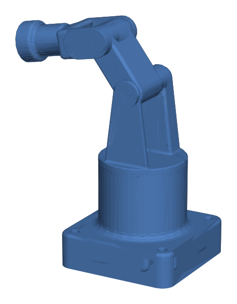
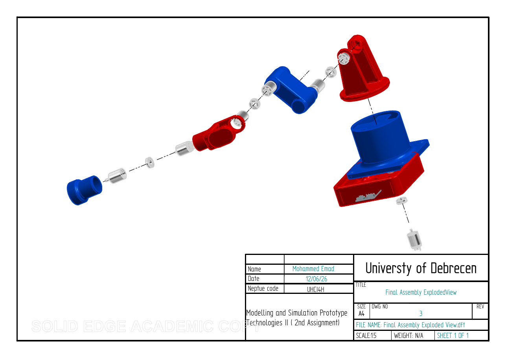

# MiniArm: 3-DOF Articulated Manipulator (Solid Edge 2026)

Modelling and Simulation Prototype Technologies II · University of Debrecen · 2025/26 spring



A small desktop arm with three revolute joints (waist, shoulder, elbow), about **230 mm** reach and a **100 g** payload. The brief was to build it around exactly three **Faulhaber 3242G 012CR** brushed DC motors. I had already characterised that motor in my [DC motor project](https://github.com/Mohammed-Emad-2004/DC-Motor-Modeling-and-Control-MATLAB-Simulink).

The goal was a design someone could actually print and assemble: 3D-printed ABS motor housings, an aluminium end-effector plate, internal cable routing, and the [motor driver PCB](https://github.com/Mohammed-Emad-2004/CAXX-Motor-Driver-PCB-KiCad) I designed mounted in the base.

<br clear="right"/>

## Design decisions

**Gearing.** The motor's rated torque (38.9 mNm) is nowhere near enough to hold the arm against gravity, so each joint gets a Faulhaber 32/3R planetary gearhead sized for its load:

| Joint | Gear ratio | Gearhead stages |
|---|---|---|
| J1 waist | 66:1 | 3 |
| J2 shoulder | 43:1 | 3 |
| J3 elbow | 14:1 | 2 (shorter housing) |

I checked static torque in the worst case, with the arm stretched out horizontally. Every joint comes out with a **safety factor above 2**.

**Motor retention.** Each motor is clamped at both ends. The front flange bolts to the housing for axial retention, and rear screws act as an anti-rotation lock against the gearhead reaction torque. This keeps the shaft concentric and stops the motor working loose under stalls and quick direction changes.

**Cable management.** A cable channel, clips and a junction block (all printed) route the motor leads inside the structure.

## Drawings



Every part and both assemblies have a PDF drawing in [`drawings/`](drawings/).

## Repository contents

```
cad/        Solid Edge parts (.par), assemblies (.asm/.cfg) and drafts (.dft)
stl/        print-ready STL for every part, plus the full assembly
drawings/   PDF technical drawings
docs/       MiniArm_Design_Report.pdf (motor data, gearing, torque check, assembly plan)
```

Motor and gearhead CAD came from Faulhaber. Every other part was modelled by me.

---
<sub>Part of [Mohammed Emad's engineering portfolio](https://github.com/Mohammed-Emad-2004).</sub>
